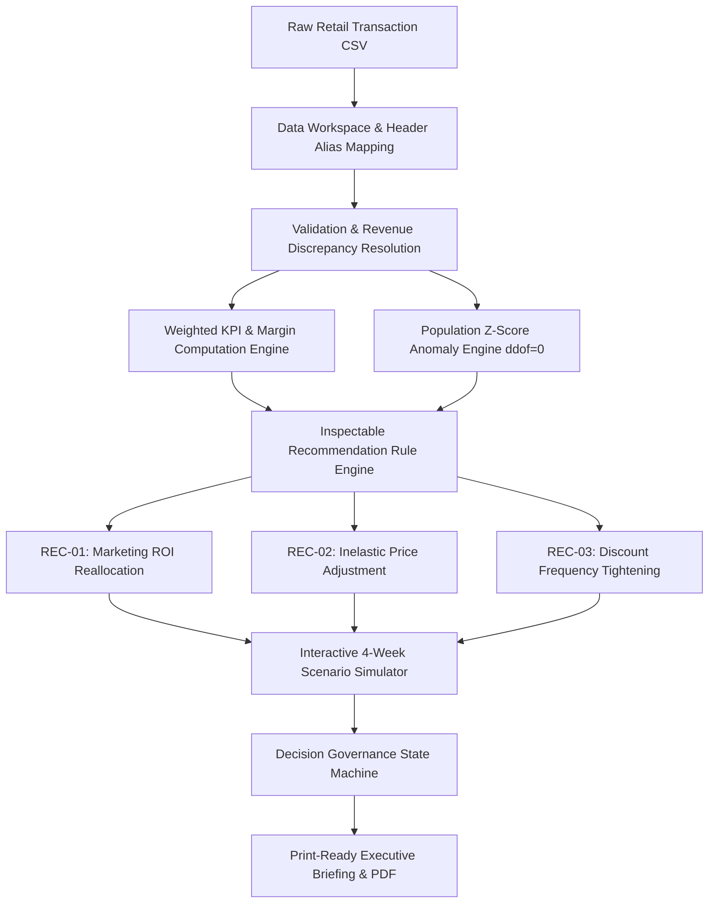
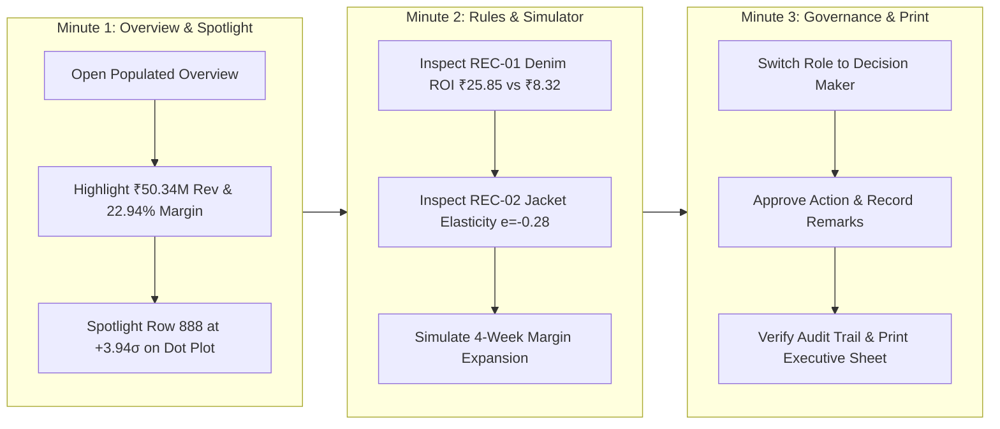
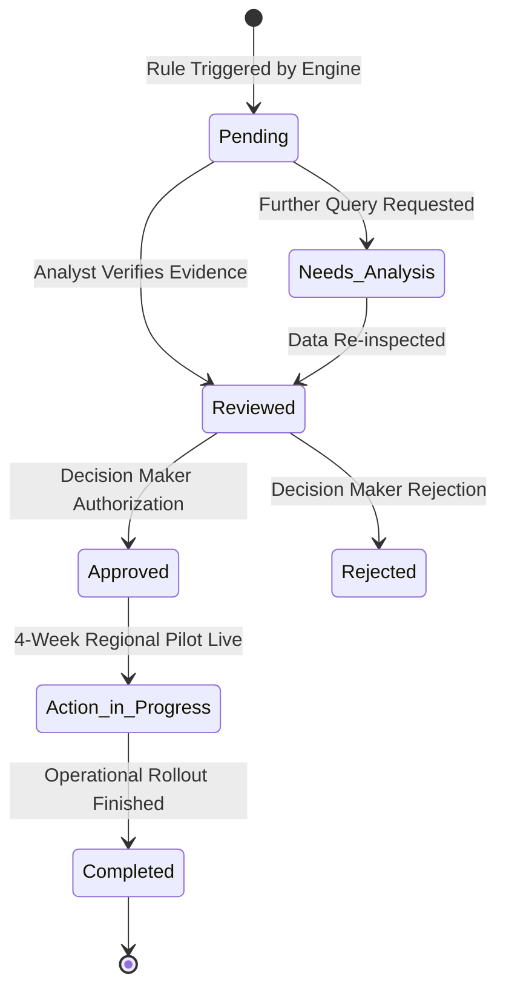

# Vyaptiq IQ — Data Driven Retail Intelligence For Revenue Growth

[](https://reactjs.org/)
[](https://www.typescriptlang.org/)
[](https://vitejs.dev/)
[](https://tailwindcss.com/)
[](https://opensource.org/licenses/MIT)

> **B.Tech Major Project Review Application (Academic Year 2026–2027)**  
> **Department of Information Technology, NRI Institute of Technology (Autonomous)**  
> Affiliated with **Jawaharlal Nehru Technological University Kakinada (JNTUK)**.  

---

## 👨‍💻 Project Developer & Attribution

- **Developer:** **Hari Sai Yugesh** ([@yugesh23](https://github.com/yugesh23))  
- **PIN:** `23KN1A1239`  
- **Role:** Sole Full-Stack Developer, Retail Systems Analyst & UI/UX Architect  
- **Project Guide:** **Mr. Ch. Kiran Babu**, Assistant Professor, Department of IT, NRIIT  
- **Head of Department:** **Dr. J. Rajendra Prasad**, Professor & HOD, Department of IT, NRIIT  

---

## 💡 Executive Summary

Retailers frequently expand gross sales volume while suffering **gross margin degradation**. Disconnected spreadsheets make it difficult to link changes in margin to specific pricing tiers, promotional discounts, SKU mixes, or advertising investments.

**Vyaptiq IQ** connects transaction validation, weighted gross margin tracking, population standard deviation $Z$-score anomaly detection, inspectable rule-based recommendations, and managerial decision governance into a single projector-ready web application.

---

## 🏗️ System Architecture & Data Flow



### The 5 Core System Modules

| Module | Purpose | Implementation Highlights |
|---|---|---|
| **M1: Authentication & Roles** | Role-based governance | Dual roles: *Business Analyst* (exploratory insights) and *Decision Maker* (approval sign-off). |
| **M2: Ingestion & Workspace** | Spreadsheet parsing | Auto-resolves aliases (`qty` → `units`, `product_id` → `sku`), detects bad types, and prompts for price discrepancies. |
| **M3: Processing Engine** | Analytics & anomalies | Computes weighted gross margin (`sum(margin) / sum(revenue) * 100`) and population $Z$-scores (`ddof=0`). |
| **M4: Decision Governance** | Operational lifecycle | Idempotent state machine (`Pending` → `Reviewed` → `Approved` → `Action in Progress` → `Completed`). |
| **M5: Reports & Visualization** | Executive delivery | Projector-optimized dashboard (1366×768) and clean `@media print` executive sheet with A/B test plans. |

---

## ⏱️ 3-Minute Projector Presentation Guide



1. **Minute 1: Baseline KPIs & The Outlier Spotlight**
   - Open on the populated Overview. Highlight the 4 headline cards: **₹50,342,560.58 Revenue**, **₹11,548,330.58 Gross Margin**, **22.94% Margin**, and **42,563 Units**.
   - Point to **Row 888** in the outlier dot plot: 50 units @ ₹2,142 = ₹107,100 (Jacket sale).
   - Explain that $+3.94\sigma$ is a statistical investigation signal for bulk institutional buying or discount leakage.

2. **Minute 2: Inspect Business Evidence Behind Recommendations**
   - Navigate to **Recommendations**:
     - **REC-01 (Denim):** Marketing return is ₹25.85 per ₹1 spent vs ₹8.32 baseline (+210% delta).
     - **REC-02 (Jacket):** Inelastic demand ($|e| = -0.28 < 0.5$) with 16.10% margin (< 20%); test 4% price increase.
     - **REC-03 (T-Shirt):** 38.0% promo rate exceeds 25% ceiling with low margin (< 20%); test promo tightening.
   - Adjust the **4-Week Scenario Simulator** to preview projected gross-margin expansion.

3. **Minute 3: Role Switch, Decision Recording & Executive Briefing**
   - In the top bar, switch Demo Role to **Decision Maker**.
   - Click **Approve Action** on REC-01 and record a management remark: *"Approved for 4-week regional pilot test."*
   - Navigate to **Decisions** to verify the permanent audit trail.
   - Navigate to **Reports** and click **Print / Save PDF** to generate the executive sheet.

---

## 🔄 Decision Governance State Machine



---

## 🛠️ Technology Stack

- **Frontend Core:** React 18, TypeScript, Tailwind CSS, Lucide Icons
- **Bundler & Dev Server:** Vite 5
- **Dual Persistence Architecture:**
  - **Local Review Mode (Default):** Browser `localStorage` adapter for instant zero-dependency execution.
  - **Connected Mode:** Supabase PostgreSQL backend with Row-Level Security (RLS) policies (`supabase/migrations/20261123_init.sql`).
- **Automated Verification:** Standalone Node.js test script (`verify_suite.js`) and in-app audit runner.

---

## 🚀 Quick Start (Local Development)

```bash
# 1. Clone repository
git clone https://github.com/yugesh23/vyaptiq-iq.git
cd vyaptiq-iq

# 2. Install dependencies
npm install

# 3. Start development server
npm run dev
```

Open **`http://localhost:5173`** in your browser.

---

## 🧪 Specification Verification Suite

Run the automated test suite directly from the command line:

```bash
node verify_suite.js
```

### Verified Audit Results

| Test Check | Specification Requirement | Engine Outcome | Status |
|---|---|---|:---:|
| **Arithmetic Benchmark** | 2 units @ ₹100 (cost ₹60) + 1 unit @ ₹200 (cost ₹150) | Units: 3, Rev: ₹400, GM: ₹130, GM%: 32.5%, Promo: 50%, ARPU: ₹200 | **PASS** |
| **Outlier Row 888** | 50 units @ ₹2,142 = ₹107,100 | Rev: ₹107,100.00, Population Z: +3.94σ | **PASS** |
| **Roundtrip Test** | Ingest → Download CSV → Re-upload | Identical revenue (₹50,342,560.58) and units (42,563) | **PASS** |
| **Zero Variance** | Transactions with identical revenue | Graceful detection; divide-by-zero prevented | **PASS** |
| **Missing Cost** | Omitted cost column | Silently assuming zero cost prevented; flagged | **PASS** |
| **Missing Customer ID** | Omitted customer identifier | ARPU reported as null with clear explanatory denominator | **PASS** |
| **Rule Boundaries** | Exactly 20.0% margin, 25.0% promo, 20.0% delta | Evaluated against strict inequality rules | **PASS** |
| **Role Authority** | Separation of duties | Analyst restricted from Approvals; Decision Maker authorized | **PASS** |

---

## 🔗 Supabase Connected Backend Setup (Optional)

1. Create a project on [supabase.com](https://supabase.com).
2. Execute [`supabase/migrations/20261123_init.sql`](supabase/migrations/20261123_init.sql) in the Supabase SQL Editor.
3. Copy `.env.example` to `.env` and set your credentials:
   ```env
   VITE_SUPABASE_URL=https://your-project-id.supabase.co
   VITE_SUPABASE_ANON_KEY=your-anon-key
   ```

---

## 📜 Academic Boundaries & Future Work

- **Scope:** Evaluated on historical retail transaction fixtures. No commercial deployment or external A/B test is claimed.
- **Future Scope:** Machine learning demand forecasting (ARIMA/Prophet), streaming POS/ERP data ingestion, and automated SHAP explainability.

---

## 📄 License

Developed for academic review purposes by **Hari Sai Yugesh** at NRI Institute of Technology (Autonomous), affiliated with JNTU Kakinada. Released under the [MIT License](LICENSE).
