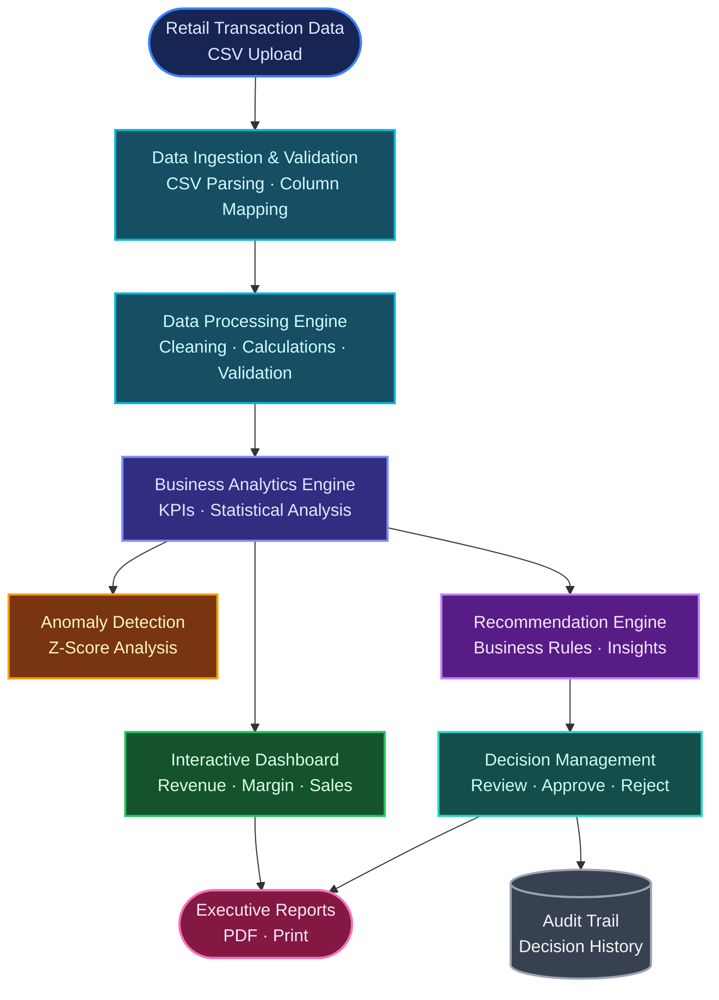
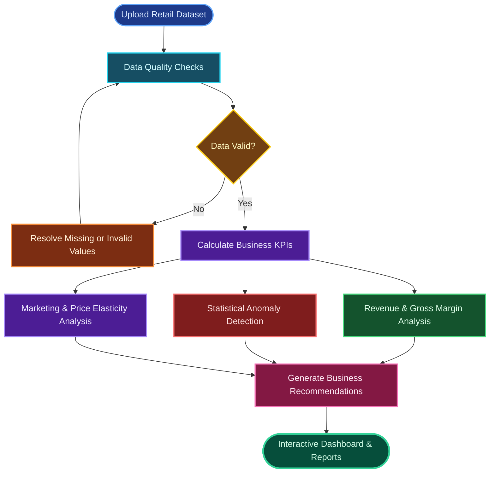
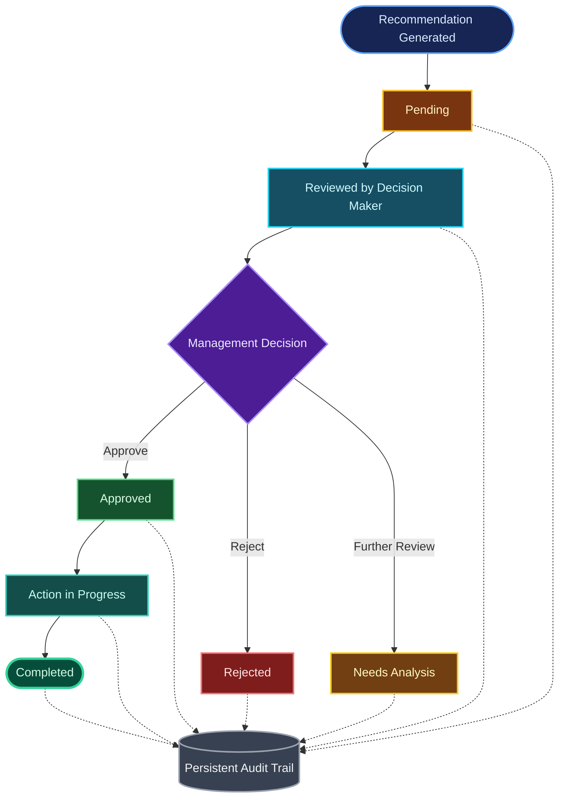

# Vyaptiq IQ
### Data-Driven Retail Intelligence for Revenue & Profitability Growth

<p align="center">
  <strong>Transforming Retail Transactions into Actionable Business Intelligence</strong>
</p>

<p align="center">
  
  
  
  
</p>

<p align="center">
  
  
  
</p>

---

## 1. Project Overview

**Vyaptiq IQ** is an interactive Retail Business Intelligence and Decision Support Platform developed to help businesses understand sales performance, monitor profitability, identify unusual transactions, evaluate marketing effectiveness, and make data-driven decisions.

Traditional sales reporting often focuses heavily on revenue while overlooking important business factors such as gross margin, promotional discounts, product profitability, and marketing expenditure.

Vyaptiq IQ addresses this problem by combining business analytics, statistical analysis, data visualization, and decision management into a unified platform.

The application converts raw retail transaction data into meaningful business insights through automated KPI calculations, anomaly detection, explainable recommendations, and interactive scenario analysis.

### The Core Objective

Move beyond simply understanding how much a business sells and understand how much it actually earns, where profitability is being lost, and what actions management should take.

---

## 2. Problem Statement

Retail businesses frequently encounter challenges such as:

- High revenue without proportionate profitability.
- Excessive promotional discounts reducing gross margins.
- Difficulty identifying unusual or high-value transactions.
- Inefficient marketing expenditure.
- Limited understanding of product-level performance.
- Disconnected spreadsheets and manual reporting.
- Lack of structured processes for reviewing and approving business recommendations.

Vyaptiq IQ provides an integrated analytics environment to address these challenges.

---

## 3. Key Features

### Business Intelligence Dashboard
- Interactive executive dashboard.
- Total revenue and gross margin tracking.
- Gross margin percentage monitoring.
- Total units sold analysis.
- Business KPI visualization.

### Data Ingestion & Validation
- CSV transaction data upload.
- Automatic column alias mapping.
- Data quality validation.
- Missing and invalid value handling.
- Revenue and quantity consistency checks.

### Retail Performance Analytics
- Product and SKU-level analysis.
- Revenue and profitability evaluation.
- Promotional discount analysis.
- Marketing performance evaluation.
- Customer-level revenue metrics.

### Statistical Anomaly Detection
- Population mean and standard deviation calculations.
- Z-score-based outlier identification.
- Transaction-level anomaly visualization.
- Investigation-focused statistical insights.

### Recommendation Engine
- Rule-based business recommendations.
- Marketing efficiency evaluation.
- Price elasticity analysis.
- Promotional threshold monitoring.
- Evidence-based recommendation explanations.

### Scenario Simulator
- Interactive four-week business scenario simulation.
- Adjustable business assumptions.
- Projected gross-margin analysis.
- Comparison of potential business outcomes.

### Decision Management
- Analyst and Decision Maker role separation.
- Recommendation review and approval.
- Action status management.
- Persistent decision audit trail.

### Executive Reporting
- Executive reporting dashboard.
- Printable management reports.
- PDF export through browser printing.
- Business performance summaries.

---

## 4. System Architecture

The application is divided into five major functional modules that work together to transform raw retail data into actionable business intelligence.



### Five Core Modules

| Module | Responsibility |
|---|---|
| Authentication & Roles | Analyst, Decision Maker, and Admin permissions |
| Data Workspace | CSV ingestion, column mapping, and validation |
| Analytics Engine | KPI calculations, statistical analysis, and elasticity |
| Decision Governance | Recommendation review, approval, and auditing |
| Reporting & Visualization | Interactive dashboards and executive reports |

---

## 5. Data Analytics Workflow

The following workflow illustrates how the platform processes retail transaction data.



---

## 6. Business Analytics Concepts & Calculations

Vyaptiq IQ incorporates several important concepts from Business Analytics, Retail Analytics, and Statistics.

### 6.1 Revenue

Revenue represents the total amount of money generated through product sales.

**Formula:**

Revenue = Selling Price × Quantity Sold

### 6.2 Gross Margin

Gross margin represents the amount remaining after subtracting the cost of goods sold from revenue.

**Formula:**

Gross Margin = Revenue − Cost of Goods Sold

### 6.3 Gross Margin Percentage

Measures the percentage of revenue retained after accounting for the cost of goods sold.

**Formula:**

Gross Margin % = (Gross Margin / Revenue) × 100

### 6.4 SKU (Stock Keeping Unit)

A SKU is a unique identifier assigned to a product or product variant to help businesses track inventory, sales, and product performance.

Example: A particular T-shirt design in a specific size and color can have its own SKU.

### 6.5 ARPU (Average Revenue Per User)

ARPU measures the average revenue generated per customer or user during a specified period.

**Formula:**

ARPU = Total Revenue / Number of Unique Customers

### 6.6 Standard Deviation

Standard deviation measures how much individual observations vary from the average value.

A higher standard deviation indicates greater variation in the dataset.

### 6.7 Z-Score

A Z-score measures how far a particular observation is from the mean in terms of standard deviations.

**Formula:**

Z = (X − μ) / σ

Where:

- X = Observed transaction value.
- μ = Population mean.
- σ = Population standard deviation.

The application uses population standard deviation (ddof = 0) for the referenced outlier calculation.

### 6.8 Anomaly Detection

An anomaly is an observation that significantly differs from the expected pattern in a dataset.

In Vyaptiq IQ, Z-scores help identify unusually high-value transactions that may require further investigation.

### 6.9 Price Elasticity of Demand

Price elasticity measures how sensitive customer demand is to changes in product prices.

**Formula:**

Price Elasticity = % Change in Quantity Demanded / % Change in Price

Interpretation:

- |Elasticity| > 1: Relatively elastic demand.
- |Elasticity| < 1: Relatively inelastic demand.
- |Elasticity| = 1: Unitary elasticity.

### 6.10 Marketing Return

Marketing return evaluates the revenue attributed to marketing relative to the amount spent.

**Formula:**

Marketing Return = Attributed Revenue / Marketing Spend

A higher value indicates more attributed revenue per unit of marketing expenditure. It should not be confused with profit-based ROI.

---

## 7. Statistical Anomaly Detection — Real Dataset Example

One of the important analytical capabilities of Vyaptiq IQ is identifying unusual transactions using statistical analysis.

### Outlier Spotlight: Transaction Row 888

The platform identifies an unusually high-value Jacket transaction.

| Parameter | Result |
|---|---:|
| Transaction Row | 888 |
| Product | Jacket |
| Quantity | 50 Units |
| Selling Price | ₹2,142 |
| Transaction Revenue | ₹107,100 |
| Population Mean | ₹27,968.09 |
| Z-Score | +3.94 |

**Calculation:**

50 × ₹2,142 = ₹107,100

The transaction has a Z-score of +3.94, indicating that its value is approximately 3.94 population standard deviations above the mean.

This represents a statistical investigation signal. It does not automatically indicate fraud, incorrect data, or a business error.

Further investigation is necessary to establish the actual cause.

---

## 8. Recommendation Engine

Vyaptiq IQ uses an explainable, rule-based recommendation engine to identify business opportunities and potential profitability issues.

The recommendations are supported by measurable business indicators.

### Recommendation Examples

| ID | Product | Business Insight |
|---|---|---|
| REC-01 | Denim | Marketing return of ₹25.85 per ₹1 spent compared with an ₹8.32 baseline |
| REC-02 | Jacket | Price elasticity of -0.28 and gross margin of 16.10% |
| REC-03 | T-Shirt | Promotional rate of 38%, exceeding the 25% threshold, with margin below 20% |

### Understanding the Recommendations

**REC-01 — Denim**

The marketing return is significantly higher than the baseline, indicating a potential opportunity to investigate and expand marketing investment.

**REC-02 — Jacket**

Demand is relatively inelastic, but the gross margin is below the 20% threshold. Pricing and cost structures should be reviewed.

**REC-03 — T-Shirt**

The promotional rate exceeds the defined 25% ceiling while gross margin remains below 20%. Promotional strategies should be reviewed.

These recommendations are decision-support signals rather than guaranteed business outcomes.

---

## 9. Decision Management & Governance

A major feature of Vyaptiq IQ is its structured recommendation approval process.

Instead of generating recommendations without accountability, the platform allows authorized decision makers to review and record business actions.

### Decision Lifecycle



### Available Decision Statuses

- Pending
- Reviewed
- Approved
- Action in Progress
- Completed
- Rejected
- Needs Analysis

The audit trail provides a record of managerial decisions and recommendation status changes.

---

## 10. Scenario Simulator

The four-week Scenario Simulator helps users explore potential business improvements through adjustable assumptions.

It allows decision makers to examine how different business scenarios could affect projected gross margins.

The simulator supports:

- Business assumption adjustments.
- Four-week scenario evaluation.
- Projected gross-margin analysis.
- Comparison of potential outcomes.

The results are scenario-based projections, not guaranteed financial performance.

---

## 11. Technology Stack

| Technology | Purpose |
|---|---|
| React 18 | Frontend application development |
| TypeScript | Type-safe application development |
| Vite | Development server and build tooling |
| Tailwind CSS | Responsive interface styling |
| Lucide Icons | Interface iconography |
| Supabase | Optional PostgreSQL backend |
| PostgreSQL | Relational database |
| Node.js | Verification scripts |
| Browser localStorage | Local persistence |

### Data Persistence Architecture

Vyaptiq IQ supports two persistence modes.

**Local Review Mode**

- Uses browser localStorage.
- Supports local demonstrations and review sessions.
- Works without a connected database.

**Supabase Connected Mode**

- Uses PostgreSQL as the backend database.
- Includes database migration scripts.
- Supports Row-Level Security (RLS) policies.

---

## 12. Project Performance & Dataset Results

The application includes a retail transaction dataset used to demonstrate business analytics calculations and dashboard functionality.

### Dataset KPI Results

| Business Metric | Value |
|---|---:|
| Total Revenue | ₹50,342,560.58 |
| Gross Margin | ₹11,548,330.58 |
| Gross Margin Percentage | 22.94% |
| Total Units Sold | 42,563 |
| Identified Outlier | Row 888 |
| Outlier Z-Score | +3.94 |

### Verification Suite

The project includes an automated verification script to validate mathematical calculations and important application requirements.

Run the verification:

```bash
node verify_suite.js
```

### Verification Coverage

- Arithmetic benchmark calculations.
- Dataset KPI reproduction.
- Outlier identification.
- CSV download and re-upload consistency.
- Zero-variance dataset handling.
- Missing cost disclosure.
- Missing customer ID handling.
- Analyst and Decision Maker permission separation.

---

## 13. Getting Started

Follow these instructions to run Vyaptiq IQ locally.

### Prerequisites

Make sure the following are installed:

- Node.js v18 or higher.
- npm.
- Git.

### Step 1: Clone the Repository

```bash
git clone https://github.com/YOUR_USERNAME/vyaptiq-iq.git
```

### Step 2: Navigate to the Project

```bash
cd vyaptiq-iq
```

### Step 3: Install Dependencies

```bash
npm install
```

### Step 4: Start the Development Server

```bash
npm run dev
```

### Step 5: Open the Application

Visit:

```text
http://localhost:5173
```

The application should now be available in your browser.

---

## 14. Optional Supabase Backend Setup

To configure the connected PostgreSQL backend:

1. Create a project in Supabase.
2. Open the SQL Editor.
3. Execute the migration script:

```text
supabase/migrations/20261123_init.sql
```

4. Copy `.env.example` to `.env`.
5. Configure the required environment variables:

```env
VITE_SUPABASE_URL=your_supabase_project_url
VITE_SUPABASE_ANON_KEY=your_supabase_anon_key
```

**Important:** Never commit private credentials, service-role keys, or other secrets to a public GitHub repository.

---

## 15. Future Enhancements

Potential future improvements include:

- Machine learning-based demand forecasting.
- Advanced customer segmentation.
- Real-time POS and ERP integration.
- Explainable AI-based recommendation analysis.
- Predictive inventory optimization.
- Automated business performance alerts.
- Advanced sales trend analysis.

---

## 16. Project Information

| Detail | Information |
|---|---|
| Project Name | Vyaptiq IQ |
| Project Category | Retail Business Intelligence |
| Domain | Data Analytics & Business Intelligence |
| Developer | Hari Sai Yugesh |
| Department | Information Technology |
| Institution | NRI Institute of Technology (Autonomous) |
| Academic Year | 2026–2027 |

**Project Guide:** Mr. Ch. Kiran Babu, Assistant Professor

---

## 17. License

This project is developed for educational and academic purposes as part of the B.Tech curriculum at NRI Institute of Technology (Autonomous), affiliated with JNTU Kakinada.

Released under the [MIT License](LICENSE).

---

<p align="center">
  <strong>Vyaptiq IQ</strong>
  <br/>
  Turning Retail Data into Better Business Decisions.
  <br/><br/>
  Developed by <strong>Hari Sai Yugesh</strong>
</p>
